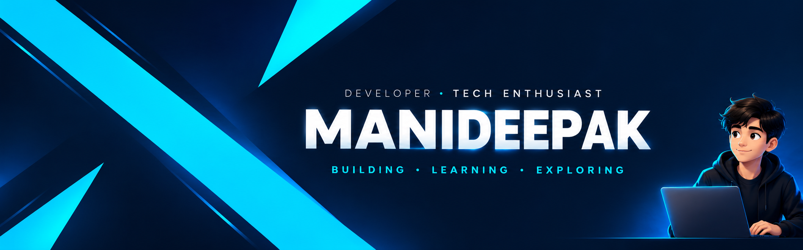

  

  <h1>Hi, I'm Manideepak 👋</h1>
  <h3>🎓 First-Year B.Tech Student | 🌱 Learning to Code</h3>

  

    <i>One step, one concept, one commit at a time.</i>
  

---

## 👨‍💻 About Me

Hey! I'm **Manideepak**, a first-year B.Tech student beginning my journey into the world of programming and technology.

I'm starting with the fundamentals, exploring how code works, and building my skills one small step at a time.

- 🎓 First-year B.Tech student
- 🌱 Currently exploring programming fundamentals
- 🧠 Interested in learning how software works
- 🛠️ Building small practice programs as I learn
- 🎯 My goal: turn what I learn into projects of my own
- 📈 This profile will grow as my skills and experience grow

---

## 🌱 My Learning Journey

This is where I'll document my progress.

| Stage | My Focus |
|---|---|
| 🌱 Starting out | Understanding programming fundamentals |
| 📚 Building foundations | Practising concepts and solving small problems |
| 🧩 Exploring | Learning new tools and technologies |
| 🛠️ Creating | Turning ideas into small projects |
| 🚀 Growing | Improving existing projects and learning from feedback |

*These are learning goals, not completed achievements. I'll update them as I progress.*

---

## 🛠️ What I'm Learning

I'm still at the beginning, so my toolkit will grow naturally.

- Programming fundamentals
- Problem-solving and logical thinking
- Git and GitHub basics

**Technologies:** I'll add them here as I learn and practise them.

---

## 📂 My Projects

I'm currently building my foundations before starting my first independent project.

As I learn, this section will feature my practice programs, experiments, and projects, including what each one taught me.

*My first project will appear here when it's ready.*

---

## 📊 My GitHub Activity

  
  

---

## 🎯 My Goals

- [ ] Build a consistent coding habit
- [ ] Learn programming fundamentals properly
- [ ] Practise using Git and GitHub
- [ ] Complete my first small project
- [ ] Share my progress through real contributions
- [ ] Build projects that solve useful problems

---

## 🤝 Connect With Me

I'm at the beginning of my journey and always happy to learn from others.

**GitHub:** [@manideepakpaladugu-sketch](https://github.com/manideepakpaladugu-sketch)

---

  <i>Every expert was once a beginner. This is my beginning. 🌱</i>
    
  <b>Thanks for visiting my profile! ⭐</b>

